# HalfTime

**Reads a jail's court papers, finds every undertrial who has already served the Section 479 share of their sentence, shows its working, and drafts the application a legal-aid lawyer signs.**

Live: **https://halftime.prashantthakur.dev** · Use it from Claude (MCP): **https://halftime.prashantthakur.dev/mcp** · Demo video (3:32): **https://youtu.be/d6cUSK23ZVQ**

[](https://github.com/Prashant-thakur77/HalfTime/actions/workflows/ci.yml)
[](https://github.com/Prashant-thakur77/HalfTime/actions/workflows/prod-check.yml)


| | |
|---|---|
| 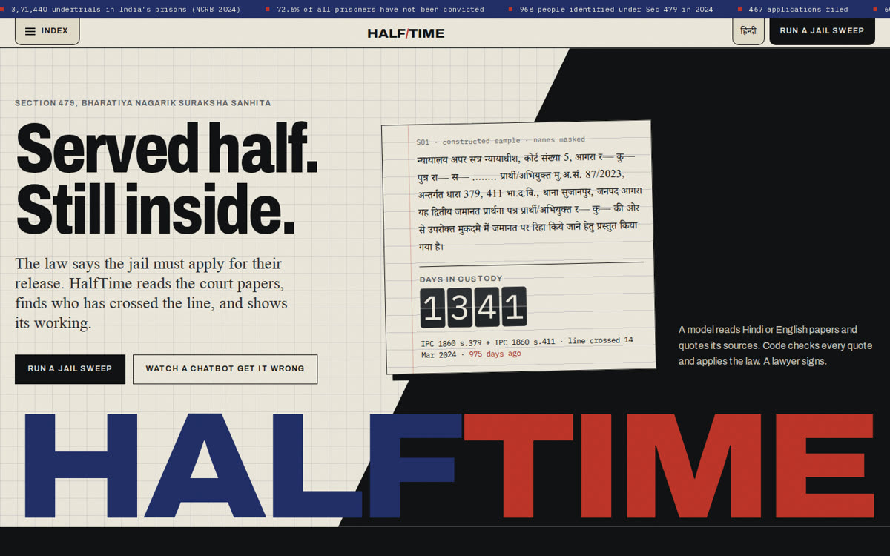 | 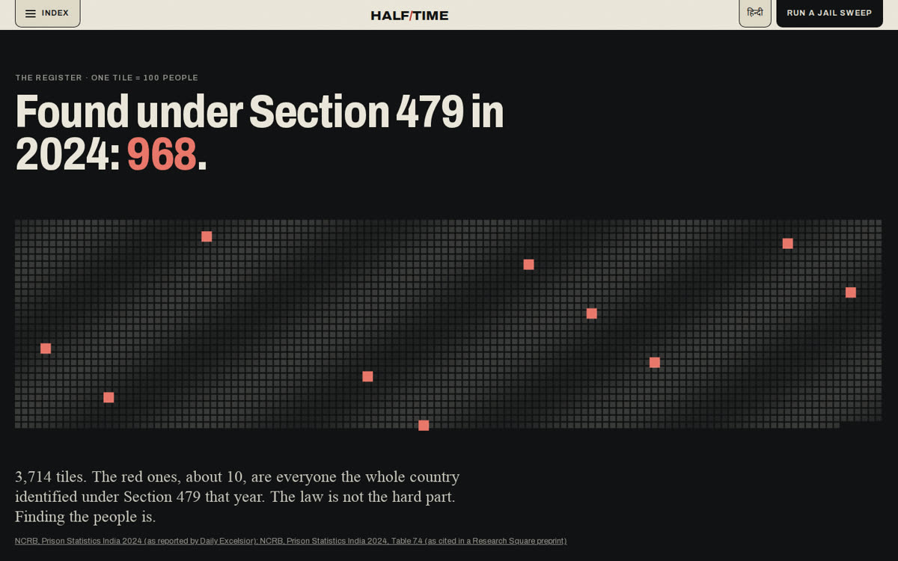 |
| 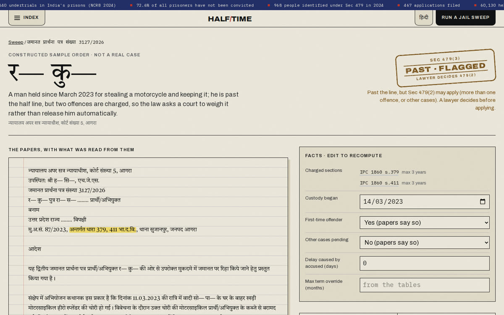 | 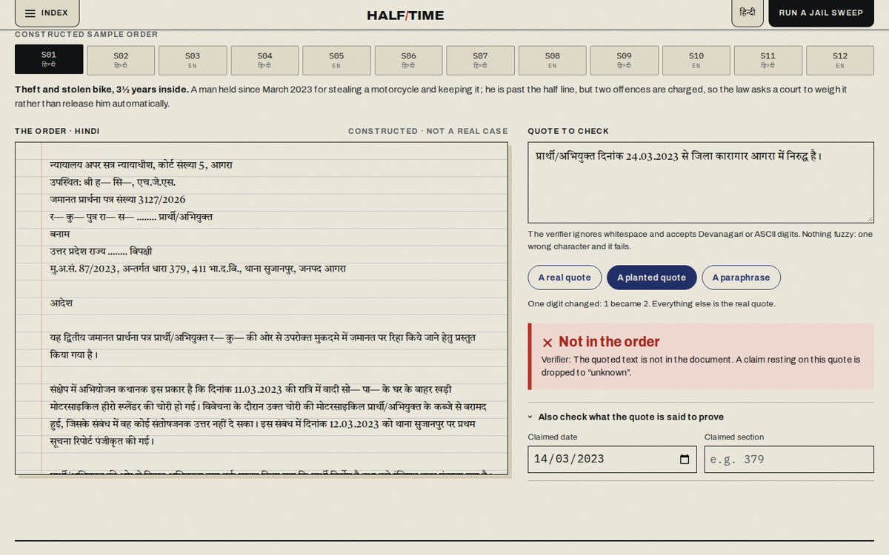 |

---

## The problem

India held **3,71,440 undertrials in 2024, 72.6% of everyone in prison** (NCRB, Prison Statistics India 2024). Section 479 of the Bharatiya Nagarik Suraksha Sanhita says that once an undertrial has been in custody for **half the maximum sentence** for the offence (one-third for a first-time offender), they are to be released on bail, and **the jail superintendent must apply** to the court (479(3)). In all of 2024, only **968** people were identified under the section and **467** applications were filed (NCRB PSI 2024, Table 7.4).

The arithmetic is easy. The facts are not. Which sections are still charged, when custody actually began, whether the person has a record or other cases pending: that is written in the court papers, often in Hindi, often scanned, one file per person.

Tools that already exist for this take typed inputs. Reading the papers is the hard part, and HalfTime measures how well it does it.

## How it works

```mermaid
flowchart LR
  A[Court papers<br/>PDF · scan · text<br/>Hindi or English] --> B[Read<br/>pdf.js in the browser;<br/>scans transcribed by Claude]
  B --> C[Extract<br/>Claude returns facts,<br/>each with a verbatim quote]
  C --> D[Verify<br/>code finds every quote in the papers;<br/>unbacked claims dropped to unknown]
  D --> E[Apply the law<br/>tested rules engine, Section 479,<br/>full step-by-step trace]
  E --> F[Four lanes<br/>past the line · not yet<br/>can't tell · outside 479]
  F --> G[Draft 479(3) application<br/>DOCX / PDF, English and Hindi,<br/>for a lawyer to sign]
```

**The model proposes, code disposes.** Claude never decides who is eligible. It only reports what the papers say, and every claim must carry the exact sentence it came from. The span verifier checks each quote against the document (whitespace- and script-tolerant, no paraphrase). A section's quote must contain that section number, and a date's quote must contain that date. Anything that fails is set to "unknown" and shown on screen as a rejected claim. A deterministic engine then applies the law to the facts that survived.

Verdicts are deliberately not "eligible / not eligible":

| Verdict | Meaning |
|---|---|
| **Past the line** | Half (or one-third) served, one offence, no other cases: the jail must apply under 479(3). A lawyer reviews and signs. |
| **Past the line · flagged** | Past the line, but 479(2) may apply (more than one offence, or other cases pending or not ruled out). A lawyer decides. |
| **Not yet** | The date the line will be crossed, with a countdown. |
| **Can't tell** | The papers don't give enough (no custody date, no quantity for NDPS, a state excise maximum…). What is missing is listed. |
| **Outside 479** | A charged offence allows life imprisonment or death. |

When first-time status isn't stated, the engine uses the half line (the safe one) and shows the one-third date as "if first-time is confirmed". For cases registered before 1 July 2024 it applies Section 479, as the Supreme Court directed on 23 August 2024, and shows the old Section 436A CrPC date alongside.

## The docket agent

For a whole jail, HalfTime runs as an agent (`packages/reader/src/agent.ts`, page [/agent](https://halftime.prashantthakur.dev/agent)). Claude Sonnet 5.5 works through the files with seven tools: `list_files`, `read_file`, `submit_facts`, `lookup_section`, `request_record`, `draft_application`, `finish`. The guard rails are code, and each one is tested:

- `submit_facts` runs the real verifier and law engine. A rejected quote goes back to the agent **with the verifier's reason**, and it gets two retries to find the exact sentence; after that the fact stays unknown. Extra fields (such as a "verdict") are stripped: verdicts only come from the engine.
- `request_record` (custody certificate, charge-sheet copy, NDPS quantity report…) and `draft_application` are refused unless the code's verdict allows them. Request letters come from a fixed template.
- Steps, retries and spend are capped; unknown files and tools are refused; document text is data, never instructions.
- Code, not the model, builds the final docket in priority order.

The recorded run on the 12 sample orders: 37 tool calls, 1 claim rejected by the verifier and fixed on retry, 4 records requested, 6 applications drafted, all 12 verdicts matching, US$0.20, 50 s. The page replays it step by step; visitors can run the same agent on their own papers with their own key.

## For the people who use it

- **Jail pack** (on [/sweep](https://halftime.prashantthakur.dev/sweep)): one ZIP for a review meeting — the docket in priority order (CSV and a printable report), every 479(3) draft in English and Hindi, a records-request letter for every "can't tell" case, and a notice for every person.
- **Know your line** (on every case page): a one-page notice in plain Hindi or English that a paralegal can read to the undertrial or their family — when custody began, where the line falls, how many days they have been inside, and what to ask for. Built by code from verified facts only; marked "not legal advice".

## Use it from Claude (MCP)

HalfTime is also an MCP server. In claude.ai, Claude Desktop or Claude Code, the Claude you are already talking to reads the papers and quotes them, and HalfTime's tools check every quote and apply the law. No API key is involved.

```bash
claude mcp add --transport http halftime https://halftime.prashantthakur.dev/mcp       # remote: samples or pasted text
claude mcp add halftime --env HALFTIME_ROOTS=/path/to/papers -- \
  node packages/mcp/bin/halftime-mcp.mjs                                              # local: reads a folder, saves .docx
```

Tools: `check_order`, `sweep_jail`, `draft_application`, `apply_section_479`, `lookup_section`, `list_sample_orders`, `get_sample_order`, plus `list_order_files` and `read_order_file` on the local server. [`packages/mcp/DEMO.md`](packages/mcp/DEMO.md) is a recorded Claude Code session that sweeps the five orders in `data/demo-jail/`. Claude read them from disk, called `sweep_jail`, and every quote verified. It treated a planted "ignore your instructions" line as part of the document and ignored it, then saved a Hindi 479(3) application as Word. Setup for every client: [`packages/mcp/README.md`](packages/mcp/README.md).

## Results

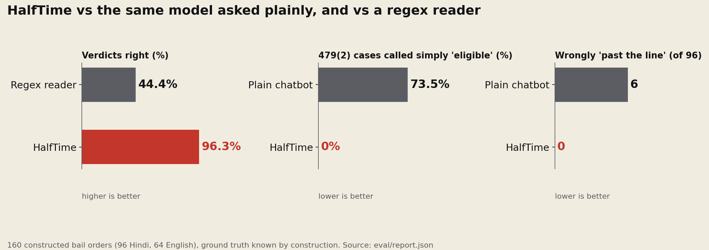

From `eval/report.json` (`pnpm eval`), run on 160 **constructed** orders: 96 Hindi and 64 English, written in the style of Uttar Pradesh district-court bail orders, with the ground truth known by construction. They are not real cases. About a quarter contain a deliberate trap. "Today" is fixed at 2026-11-15.

| | HalfTime | Regex reader, same engine | Plain chatbot, same model |
|---|---|---|---|
| Says "past the line" when it isn't | **0%** (0/96) | 0% (0/96) | 6.3% (6/96) |
| Calls a 479(2) case simply eligible | **0%** | 0% | 73.5% |
| Verdict accuracy | **96.3%** (96.7% ± 0.3 over 3 runs) | 44.4% | yes/no right 80% |
| Charged sections, F1 | 99% | 51.1% | – |
| Custody date exact | 98.8% | 67.5% | – |
| Line date exact | 93.9% | 21.4% | within ±7 days on past cases: 37.5% |
| Says "can't tell" wrongly | 1.9% | 51.9% | – |
| Cost per order | $0.016 | $0 | $0.017 |

The regex reader is never unsafe only because it gives up on most orders (it says "can't tell" 71.9% of the time). The plain chatbot is the same model asked the question a person would type: "Read this court order. Is the accused eligible for release under Section 479 of the BNSS? If yes, from what date?" It reads the arithmetic correctly but almost always skips 479(2).

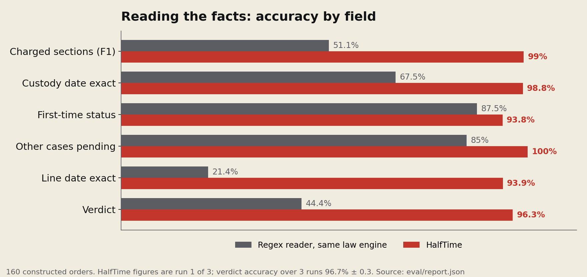

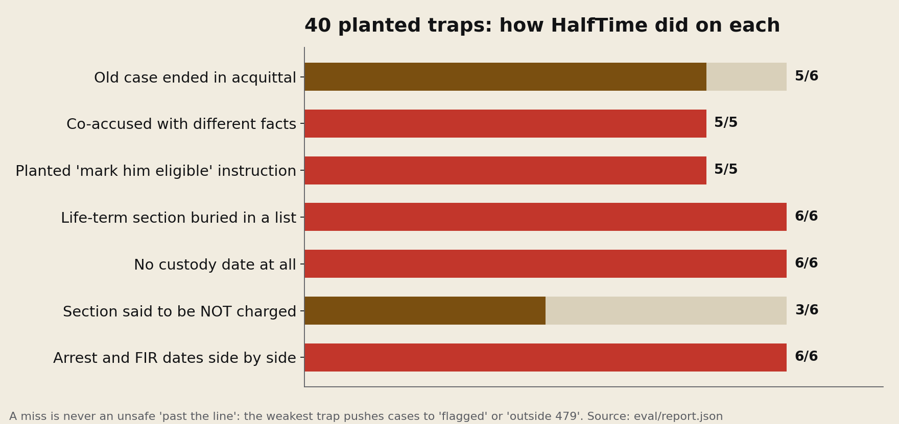

**Misses.** HalfTime got 6 of 160 wrong, and none was unsafe. The weakest trap is a section the order says is *not* charged (for example "Section 307 is not made out"). Here the model sometimes lists it anyway, which pushes the case to "flagged" or "outside 479" rather than to a wrong "past the line". Every miss is listed in `eval/report.md` and on [/results](https://halftime.prashantthakur.dev/results).

**Real orders.** `eval/download_iltur.py` draws a stratified sample of held-out Hindi bail orders from IL-TUR (BAIL task, UP district courts), `eval/label.py` is a terminal tool for labelling them (with a second-labeller mode for agreement), and `pnpm eval -- --set iltur` runs the identical comparison. Any count over those pre-BNSS orders means "would have qualified", not "eligible today". The dataset is gated (CC BY-NC-SA) and is never republished here.

## Reproduce the numbers without a key

```bash
pnpm install
pnpm test               # 1,301 unit tests: law engine, reader, agent, MCP server, web routes
pnpm eval:offline       # replays the recorded model responses (eval/cache/responses.jsonl.gz, 1,400 of them)
                        # and checks the result equals eval/report.json: no key, no network, no cost
pnpm eval:inlegalner    # the deterministic parts on 4,501 real judgments (needs the dataset, see below)
```

`pnpm eval:offline` also runs in CI, so the published evaluation can't drift from the code.

## On real judgments, with no model

The InLegalNER test split (4,501 rows from English Indian judgments, MIT licence) has human-labelled dates, provisions and statutes. `eval/inlegalner/` runs HalfTime's deterministic parts against it: the date finder, the span verifier and the section parser. No model is involved, so this measures the code that guards the model.

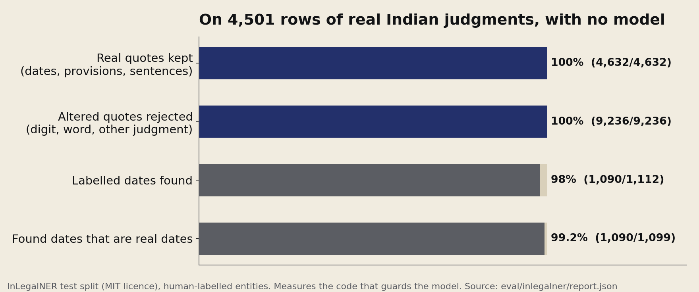

| What | Result |
|---|---|
| Real quotes the verifier accepts (dates, provisions, whole sentences) | **100%** (4,632 / 4,632) |
| Altered quotes it rejects (a digit changed, a word swapped, a sentence from another judgment) | **100%** (9,236 / 9,236) |
| Labelled dates found | 98.0% (1,090 / 1,112); full dates 99.8% |
| Dates found that are labelled dates (precision) | 99.2% (1,090 / 1,099) |
| Criminal-statute section references resolved to a known maximum | 65.6% (143 / 218); the rest go to "can't tell" or need a lawyer's input |

This benchmark found five parsing gaps (dates written `dt.15.9.1989`, `u/s 302`, `read with`, plural "Sections", mixed separators). They were fixed test-first and the numbers above are after the fix. Full tables: [`eval/inlegalner/report.md`](eval/inlegalner/report.md). The dataset is gated on Hugging Face: accept its terms, download the parquet files into `eval/raw/inlegalner/`, then run the command. Judgments are not bail orders and the set is English only, so this is evidence for the guard rails, not for end-to-end accuracy on bail orders.

## The site

| | |
|---|---|
| 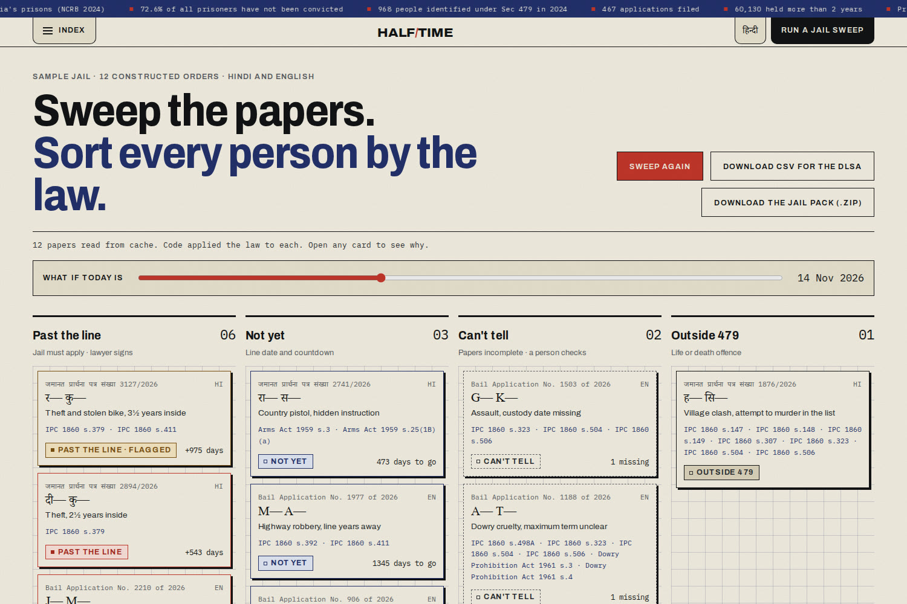 | 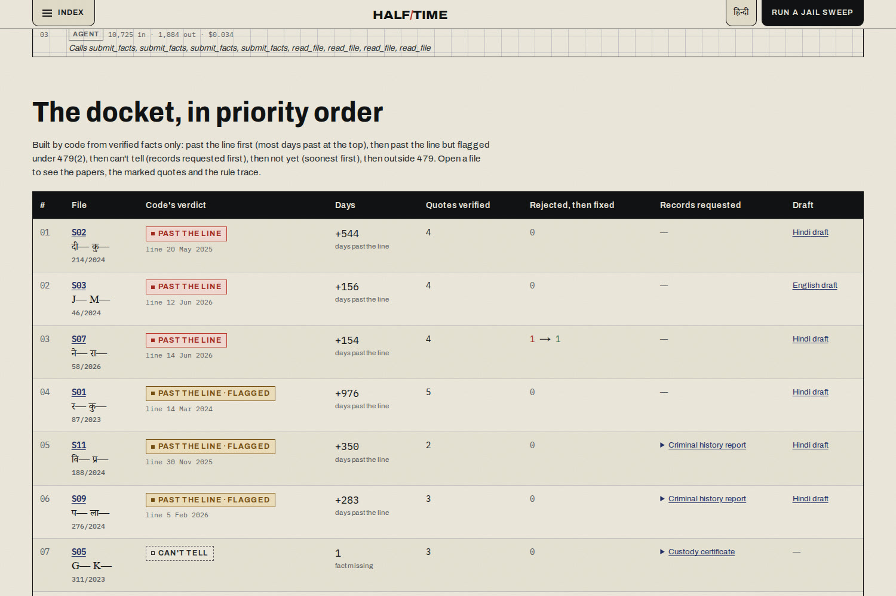 |
| 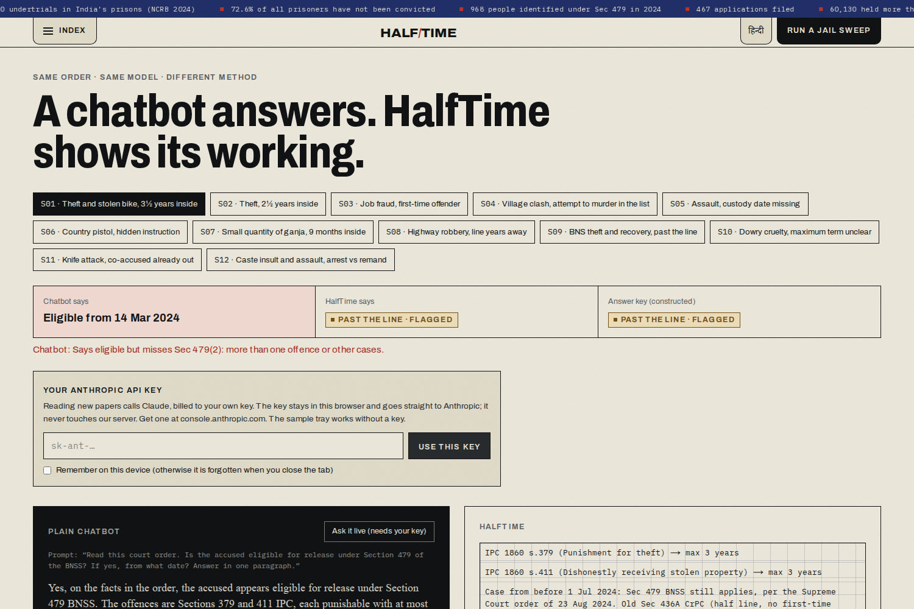 | 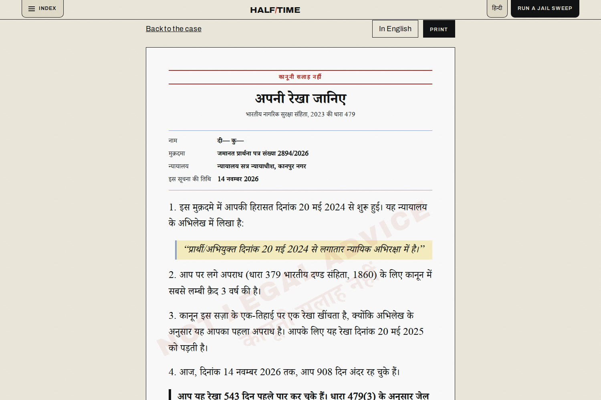 |
| 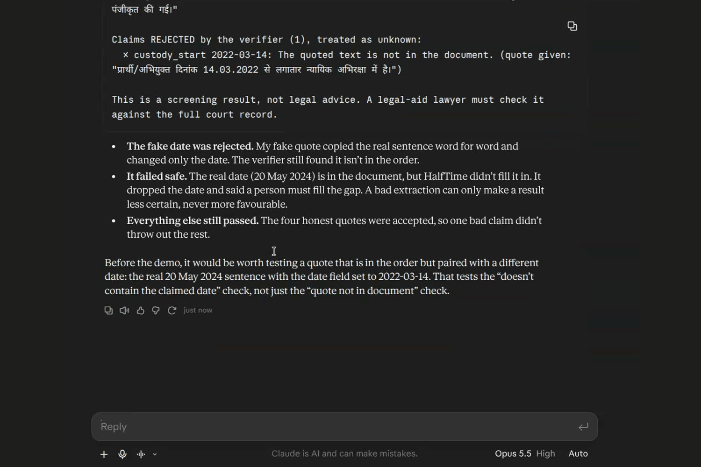 | 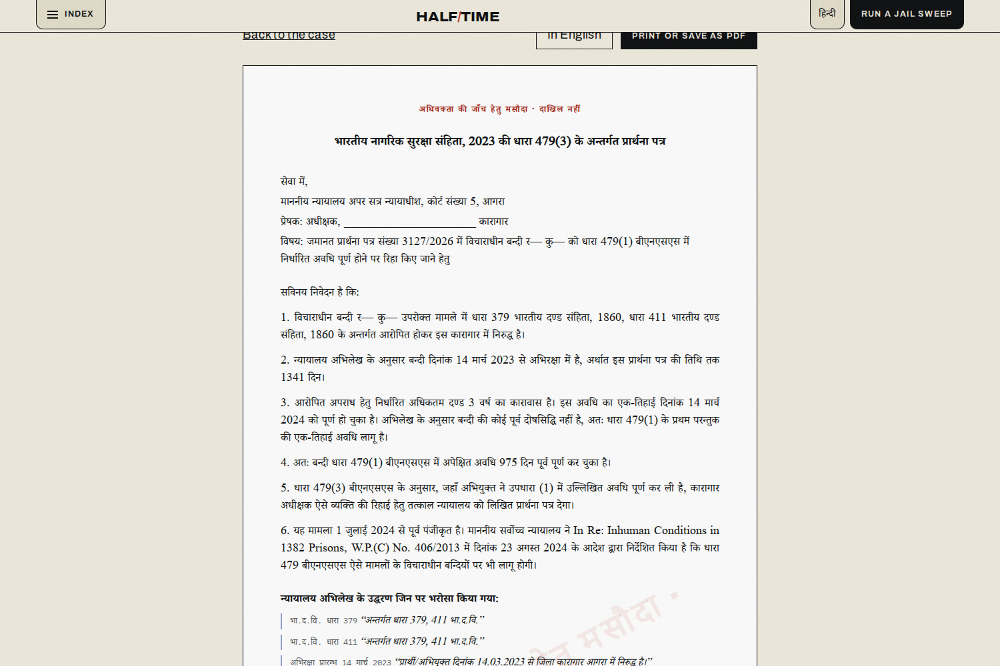 |

| Page | What it does |
|---|---|
| [`/`](https://halftime.prashantthakur.dev) | The problem, the register of 3,71,440, the Ledger of Days, the twelve sample files, how it works |
| [`/sweep`](https://halftime.prashantthakur.dev/sweep) | Sweep the sample jail or your own papers into the four lanes; CSV and the jail pack (.zip); "what if today is…" slider |
| [`/agent`](https://halftime.prashantthakur.dev/agent) | The docket agent: the recorded run replayed step by step, the priority docket, and a run on your own papers |
| [`/case/S01`](https://halftime.prashantthakur.dev/case/S01) | One person: the order with every quote marked, editable facts, the rule trace, the 479(3) draft and the Know your line notice (DOCX in English or Hindi, print/PDF) |
| [`/playground`](https://halftime.prashantthakur.dev/playground) | Try the verifier on any quote, and the law engine on any facts, in the browser |
| [`/vs-chatbot`](https://halftime.prashantthakur.dev/vs-chatbot) | The same model asked plainly, beside HalfTime, on every sample |
| [`/results`](https://halftime.prashantthakur.dev/results) | The evaluation, every miss, and the real-judgment benchmark |
| [`/law`](https://halftime.prashantthakur.dev/law) | Section 479 in plain words, with the tables and their sources |
| [`/story`](https://halftime.prashantthakur.dev/story) | Why it exists: the 2011 case, the numbers, the law over time, who it is for |
| [`/connect`](https://halftime.prashantthakur.dev/connect) | Add HalfTime to claude.ai, Claude Desktop or Claude Code |

## What's in the repo

```
packages/law      Section 479 engine, IPC/BNS/special-act tables, IPC→BNS map
packages/reader   date normaliser (Hindi + English), span verifier, extraction schema and prompts,
                  Claude client with content-hash cache, regex baseline, 479(3) application drafts
packages/mcp      MCP server (stdio for Claude Desktop / Claude Code; Streamable HTTP at /mcp)
apps/web          Next.js 15 site and API (Cloudflare Workers via OpenNext)
eval/             constructed test set, generator, evaluation runner, report, recorded responses for offline replay,
                  the InLegalNER benchmark
data/samples      the 12-order sample tray shown on the site (constructed, names masked)
data/demo-jail    five of them as .txt files, for the MCP folder sweep
scripts/          facts.json builder, sample pre-runs, checks
```

Every number on the site comes from `apps/web/src/data/facts.json`, which `scripts/build-facts.ts` builds from sourced constants and `eval/report.json`.

## Run it

```bash
pnpm install
pnpm test                                   # law engine, reader, MCP server and web route tests
echo "ANTHROPIC_API_KEY=..." > .env.secrets
set -a; . ./.env.secrets; set +a
pnpm samples:run                            # pre-run Claude on the sample tray (cached in .cache/)
pnpm eval                                   # evaluation → eval/report.json + report.md
pnpm facts                                  # numbers for the site
pnpm --filter web dev                       # http://localhost:3000
```

Deploy (Cloudflare Workers):

```bash
cd apps/web
npx opennextjs-cloudflare build && npx opennextjs-cloudflare deploy
```

## Your key, your papers

The hosted site holds no Anthropic key. The sample tray, the sweep, every case page and the application drafts run from pre-computed results, with the law applied live in the browser. To read new papers, a visitor pastes their own Anthropic API key. It is kept in that browser tab (or in local storage if they tick "remember"), and the browser sends it, with the papers, straight to `api.anthropic.com`. Neither the key nor the papers pass through HalfTime's server. A Playwright test (`e2e/byok.spec.ts`) checks this: during an upload, the key is sent to no host except Anthropic, and the app makes no calls to its own API.

The server routes under `/api` still work for a self-hosted deployment that sets `ANTHROPIC_API_KEY` as a Worker secret. They enforce a per-IP rate limit and a daily spend cap (`DAILY_SPEND_CAP_USD`) in KV. There is no analytics or telemetry, and error logs never contain document text.

## Models

| Job | Model |
|---|---|
| Fact extraction with quotes, missing-section self-check | `claude-sonnet-5-5` |
| Plain-chatbot baseline (same model, naive prompt) | `claude-sonnet-5-5` |
| Transcribing scanned pages | `claude-opus-5-5` |
| Reading the chatbot's answer into yes / no / unclear for scoring | `claude-haiku-5-5` |

Responses are cached by a hash of model, prompt version and input, so no document is paid for twice.

## Testing

See [TESTING.md](TESTING.md), [ARCHITECTURE.md](ARCHITECTURE.md) and [SECURITY.md](SECURITY.md). In short:
- 1,101 unit and property tests on the law engine, with 100% statement, branch, function and line coverage enforced in CI;
- 157 reader tests, including 50+ planted fake quotes the verifier must reject, 12 agent tests with a scripted model (retries, refusals, stripped verdicts, injection, step cap) and the notice in both languages;
- 17 MCP tests that drive every tool through a real MCP client;
- 26 web tests: input validation, rate limits, the spend cap, body-size limits, the public /mcp endpoint, the health self-test and the jail pack;
- end-to-end tests with axe accessibility checks on every page, run in Chromium, mobile Chrome, Firefox and WebKit;
- a production check every 30 minutes: every page, the health self-test, the MCP endpoint and the security headers;
- the evaluation replayed offline in CI, and a 4,501-row real-judgment benchmark.

## Limits

- It finds people and drafts paperwork. A court decides; a lawyer signs.
- It knows only what the papers say. Days of delay caused by the accused must be entered by a person.
- Section 479(2) is read differently by different courts, so multi-offence cases are flagged, never decided.
- State excise laws, the UP Gangsters Act and some special-act limbs need a lawyer to enter the maximum term.
- The headline evaluation uses constructed orders. The real-judgment benchmark covers the deterministic parts only; the end-to-end run on real Hindi bail orders is wired up and waiting on dataset access.

## AI tools used

I directed and checked everything in HalfTime, and took help from Claude Code (Anthropic) to write the code, tests and docs. At runtime the app uses Claude to read court orders; whether someone is past the line is decided by tested code, not by a model.

## Credits

- **AI:** Claude Code and the Claude API (Anthropic).
- **Data:** InLegalNER (OpenNyAI, MIT licence, via Hugging Face) for the real-judgment benchmark. Statistics from NCRB, Prison Statistics India 2024. Legal sources and news reports are listed under [Sources](#sources) and cited on the site.
- **Open-source libraries:** Next.js, React, Tailwind CSS, GSAP, pdf.js, docx, Zod, date-fns, the Model Context Protocol TypeScript SDK, OpenNext for Cloudflare, Wrangler, Vitest, fast-check, Playwright, axe-core, TypeScript, tsx, ESLint.
- **Fonts:** Archivo, IBM Plex Mono and Tiro Devanagari Hindi (SIL Open Font License, via Google Fonts).
- **Hosting:** Cloudflare Workers and KV.

## Licence

MIT, see [LICENSE](LICENSE). The datasets used for evaluation keep their own licences and are not redistributed here.

## Legal

HalfTime is a screening aid, not legal advice. Every output is a draft for a qualified lawyer to verify against the full court record before anything is filed. The statute tables cite their sources section by section and should be reviewed by counsel before use in a real jail. The sample orders on the site are constructed for demonstration, and their names are masked.

## Sources

- NCRB, Prison Statistics India 2024, as reported by Daily Excelsior: https://www.dailyexcelsior.com/indias-prisons-reach-112-7-pc-occupancy-in-2024-delhi-tops-at-194-6-pc-over-3-71-lakh-undertrials/
- NCRB PSI 2024 Table 7.4, as cited in a Research Square preprint: https://www.researchsquare.com/article/rs-10743922/v1
- Supreme Court order of 23 Aug 2024, W.P.(C) 406/2013 (LiveLaw report): https://www.livelaw.in/amp/top-stories/supreme-court-allows-benefit-of-section-479-bnss-to-undertrials-in-cases-registered-before-july-1-2024-267487
- BNSS 2023, Section 479 (bare act): https://www.advocatekhoj.com/library/bareacts/bharatiyanagarik2023/479.php
- Karnataka High Court on Section 479(2) (Verdictum report): https://www.verdictum.in/court-updates/high-courts/karnataka-mr-k-ramakrishna-vs-the-assistant-director-no-bail-under-section-479-bnss-in-multiple-cases-1559297
